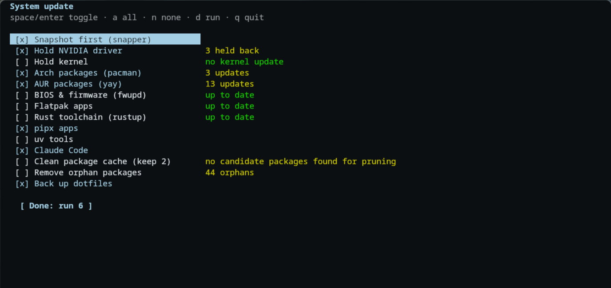

<h1 align="center">📦 sysupdate 📦</h1>

<p align="center">
<b>A terminal menu for Arch that updates everything at once.</b>
</p>

<div align="center">
 <br>
</div><br>

<p align="center">
  <a href="https://sevvy-wevvy.com/discord">
    
  </a>
</p>
<p align="center">
  <a href="https://sevvy-wevvy.com/donate" target="_blank">
    
  </a>
</p>

<p align="center">
  sysupdate is a small menu where you pick what you want to update and it runs all of it for you.<br>
  It does pacman, AUR, firmware, flatpak and more. I was sick of typing all of them out every time.<br><br>
  Do you like this? If so, please let me know!
  <a href="https://sevvy-wevvy.com/discord">Discord</a>
</p>

<details>
<summary align="center"><b>✅ Install ✅</b></summary>

<p align="center">
Put sysupdate.py somewhere in your PATH and run it.<br>
You need <code>pacman-contrib</code> for it to work. Anything else you dont have just wont show in the menu.
</p>

```sh
curl -Lo ~/.local/bin/sysupdate https://raw.githubusercontent.com/sevvy-wevvy/sysupdate/main/sysupdate.py
chmod +x ~/.local/bin/sysupdate
```
</details>

<details>
<summary align="center"><b>🔄 Features 🔄</b></summary>

<p align="center">
<b>Snapshot</b> - Makes a snapper snapshot before updating<br>
<b>Mirrors</b> - Runs reflector<br>
<b>Pacman</b> - pacman -Syu<br>
<b>AUR</b> - yay or paru<br>
<b>Firmware</b> - fwupd, warns you if youre on battery<br>
<b>Flatpak, rustup, pipx, uv, npm and Claude Code</b><br>
<b>Hold NVIDIA</b> - Stops the nvidia driver from updating<br>
<b>Hold kernel</b> - Stops the kernel from updating<br>
<b>Cache</b> - Cleans the pacman cache, keeps the last 2<br>
<b>Orphans</b> - Removes orphan packages<br><br>
Stuff that has updates gets ticked on its own.
</p>
</details>

<details>
<summary align="center"><b>⌨ Keybinds ⌨</b></summary>

<p align="center">
<b>Up/Down or J/K</b> - Move<br>
<b>Space or Enter</b> - Tick<br>
<b>A</b> - Tick all<br>
<b>N</b> - Untick all<br>
<b>D</b> - Run<br>
<b>Q or Esc</b> - Quit
</p>
</details>

<details>
<summary align="center"><b>⚙️ Config ⚙️</b></summary>

<p align="center">
Executables in <code>~/.config/sysupdate/hooks</code> get added to the menu, the file name is what it shows as.<br><br>
To change what is ticked by default make <code>~/.config/sysupdate/defaults</code> like this:
</p>

```
holdnv on
orphans on
pipx off
```

<p align="center">
Keys: snap, mirrors, holdnv, holdkernel, pacman, aur, fwupd, flatpak, rustup, pipx, uv, npm, claude, cache, orphans<br><br>
If you open it from a launcher or keybind set <code>SYSUPDATE_WAIT=1</code> so the window stays open at the end.
</p>

```sh
kitty --class sysupdate -e env SYSUPDATE_WAIT=1 sysupdate
```
</details>

<details>
<summary align="center"><b>🛠 Pull Requests 🛠</b></summary>

<p align="center">
Want to help with this? <a href="https://github.com/sevvy-wevvy/sysupdate/pulls">Make A pull request!</a><br>
Pull request allow for anyone to request a change to this code. In turn meaning that <b>YOU</b> can contribute to this project.<br><br>
As long as it works, its very likely to get accepted.
</p>
</details>

<details>
<summary align="center"><b>⚖️ License ⚖️</b></summary>

<p align="center">
  <small>
    <b>sysupdate</b> is released under the
    <a href="https://www.gnu.org/licenses/gpl-3.0.html" target="_blank">GPL-3.0 License</a>.
    This means you’re free to use, modify, and share the code. As long as you:
  </small>
</p>

<p align="center">
  <small>
    • Keep your changes <b>open-source</b> under the same license. <br>
    • <b>Give proper credit</b> to the project and original contributors. <br>
    • Include a copy of the <a href="https://www.gnu.org/licenses/gpl-3.0.html">GPL-3.0 license</a> with your distribution.
  </small>
</p>

<p align="center">
  <small>
    In short: play fair, keep it open, and give credit where it's due.
  </small>
</p>
</details>

<details>
<summary align="center"><b>🩷 Donate 🩷</b></summary>

<p align="center">
I accept donations on a few platforms. Here's where you can help support my projects and more.<br>
<b>Ko-fi</b> (Preferred) - https://sevvy-wevvy.com/kofi<br>
<b>Patreon</b> - https://sevvy-wevvy.com/patreon<br>
<b>Throne</b> - https://sevvy-wevvy.com/throne
</p>
</details>
